# 🚢 Portall - Port Management System
端口管理系统


Portall provides an intuitive web-interface for generating, tracking, and organizing ports and services across multiple hosts.  
Portall 提供了一个直观的网页界面，用于生成、追踪和管理多个主机上的端口和服务。

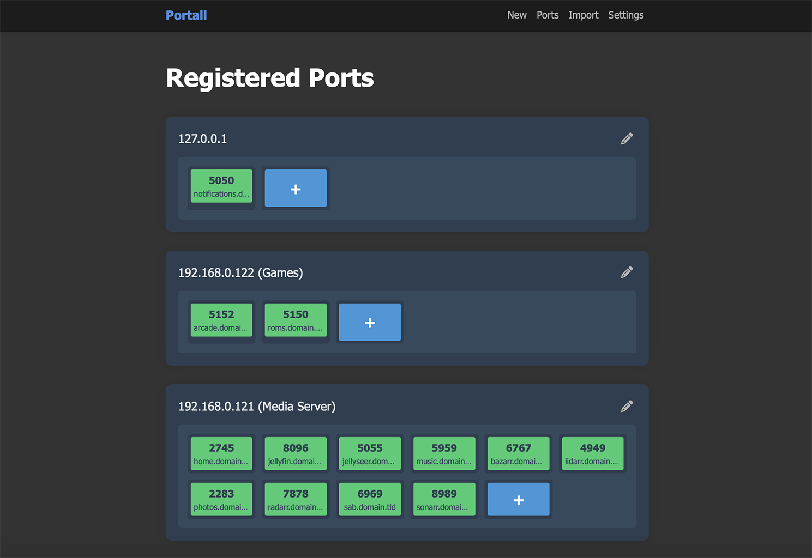

## 部署说明

当前汉化仅适用于 1.0.8 版本：

首先感谢原作者的开源。[原项目地址](https://github.com/need4swede/Portall)

具体汉化了那些内容，请参考[翻译说明](翻译说明.md)。

只做了汉化和简单修改。

有需要帮忙部署这个项目的朋友,一杯奶茶,即可程远程帮你部署，需要可联系。  
微信号 `E-0_0-`  
闲鱼搜索用户 `明月人间`  
或者邮箱 `firfe163@163.com`  
如果这个项目有帮到你。欢迎start。

有其他的项目的汉化需求，欢迎提issue。或其他方式联系通知。

### 镜像

从阿里云或华为云镜像仓库拉取镜像，注意填写镜像标签，镜像仓库中没有`latest`标签

容器内部端口 8080 可通过设置环境变量`PORT`的值来指定监听端口

```bash
swr.cn-north-4.myhuaweicloud.com/firfe/portall:1.0.8
```

把下面示例中的`端口`替换为实际端口。

### docker run 命令部署

```bash
docker run -d \
--name portall \
--network bridge \
--restart always \
--log-opt max-size=1m \
--log-opt max-file=1 \
-v ./data:/app/instance \
-p 端口:8080 \
swr.cn-north-4.myhuaweicloud.com/firfe/portall:1.0.8
```
### compose 文件部署 👍推荐

```yaml
#version: '3.9'
services:
  portall:
    container_name: portall
    image: swr.cn-north-4.myhuaweicloud.com/firfe/portall:1.0.8
    network_mode: bridge
    restart: always
    logging:
      options:
        max-size: 1m
        max-file: '1'
    ports:
      - 端口:8080
    volumes:
      - ./data:/app/instance
```

## 修改说明

这里对除了汉化之外的代码修改的说明。  
增加修改部分具体见 [修改说明](./修改说明.md)。

`./README.md` 文件翻译，增加 `## 部署说明`、`## 修改说明`、`## 效果截图` 部分。

增加目录 `./图片` `static/remote_files` `static/webfonts` (引用的远程文件)
新增文件 `./翻译说明.md`、`./修改说明.md`、`./本地调试命令记录.md` 

## 效果截图

| 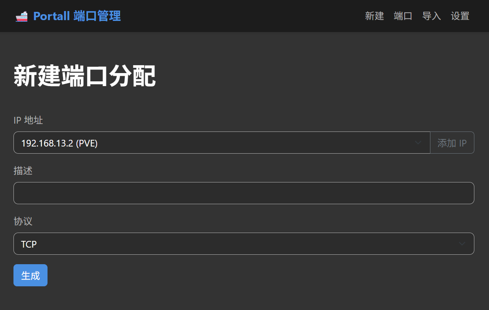 | 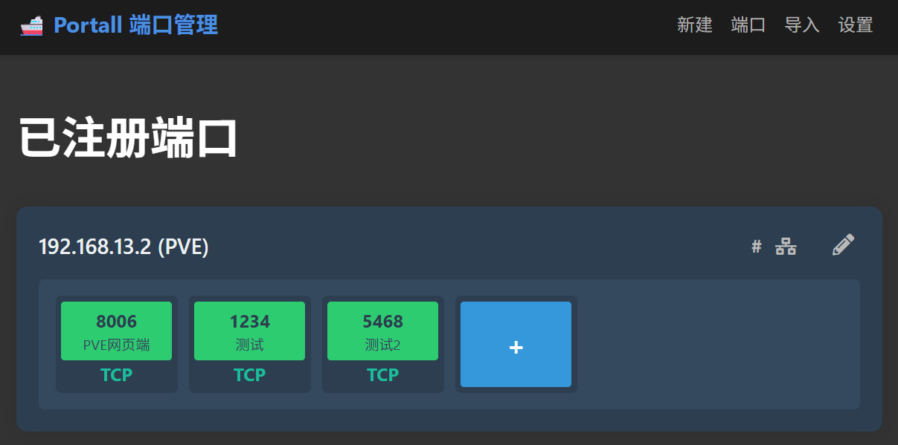 | 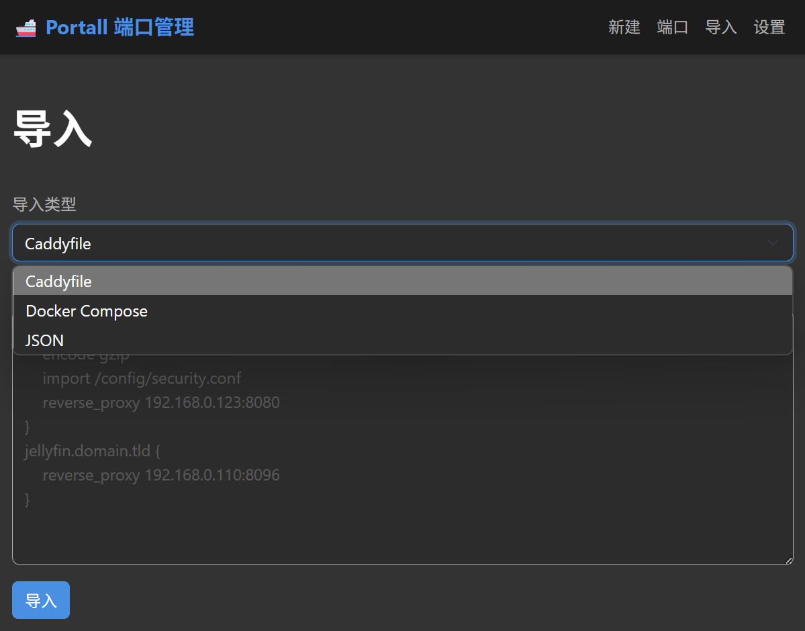 |
| --- | --- | --- |
| 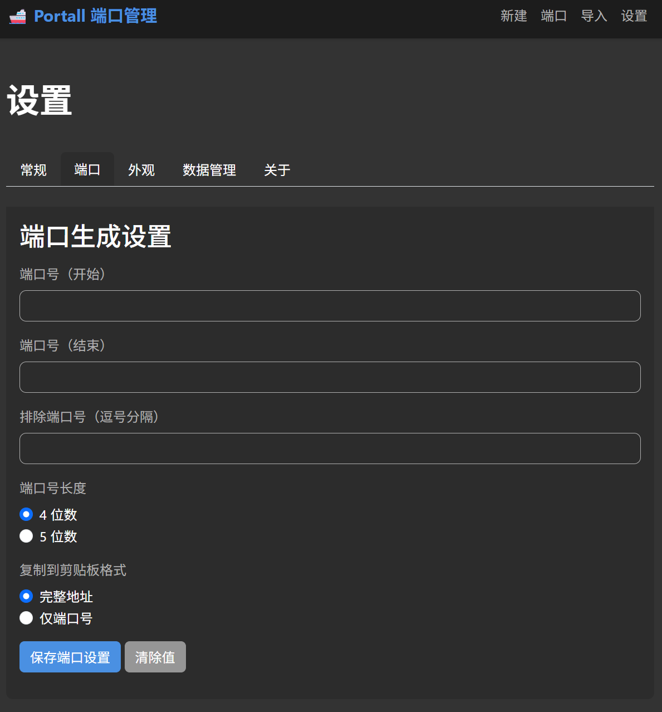 | 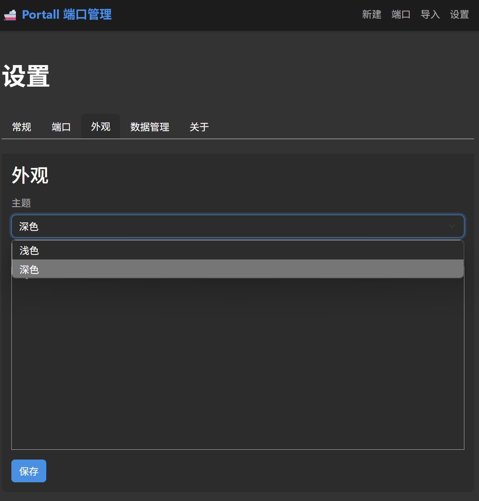 | 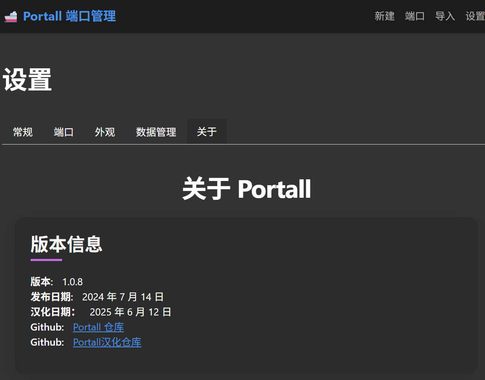 |


## 🐳 Setup 安装配置

### Docker Run

```bash
docker run -p 8080:8080 \
  -e SECRET_KEY=your_secret_key \
  -e PORT=8080 \
  -v ./instance:/app/instance \
  Portall
```

### Docker Compose
```yml
version: '3'
services:
  portall:
    image: need4swede/portall:latest
    container_name: portall
    ports:
      - "8080:8080"
    environment:
      - SECRET_KEY=your_secret_key
    volumes:
      - ./instance:/app/instance
```

## ✨ Core Functionality 核心功能

**Easy Port Management 便捷的端口管理**
   - Easily add, remove and assign ports to different services and hosts.  
     轻松添加、删除并为不同服务和主机分配端口。

**Port Number Generation 端口号生成**
   - Quickly generate unique port numbers to host your applications.  
     快速生成唯一的端口号，用于部署你的应用。

**Import Tools 导入工具**
   - Import existing configurations by pasting your Caddyfile, Docker-Compose or JSON data.  
     通过粘贴 Caddyfile、Docker Compose 或 JSON 数据，导入现有配置。

**Custom Rules 自定义规则**
   - Define your own port ranges and set exclusions for the port generator.  
     自定义端口范围，并为端口生成器设置排除规则。

## 🎨 UI Goodies 界面亮点

**Block Level Design 区块化设计**
   - Drag and drop elements to easily organize your ports and move applications between hosts.  
     拖放式元素，轻松组织端口信息，方便在不同主机间移动应用。

**Themes 主题支持**
   - Ships with both Light and Dark modes, with more themes to come.  
     内置浅色与深色模式，未来还将提供更多主题选项。

**CSS Playground CSS 自定义**
   - Want to style the UI yourself? You can modify the look and feel via Custom CSS support.  
     想自己美化界面？我们支持通过自定义 CSS 修改整体样式。

**Mobile Responsive 移动端适配**
   - Manage your ports from anywhere with fully-responsive pages.  
     页面完全响应式设计，随时随地用手机管理你的端口。

## 🛠️ Technical Stack 技术栈

- 🐍 **Backend 后端**: Flask (Python)
- 💾 **Database 数据库**: SQLAlchemy with SQLite
- 🌐 **Frontend 前端**: HTML, CSS, JavaScript

## 📸 Screenshots 截图展示

### Port Management 端口管理
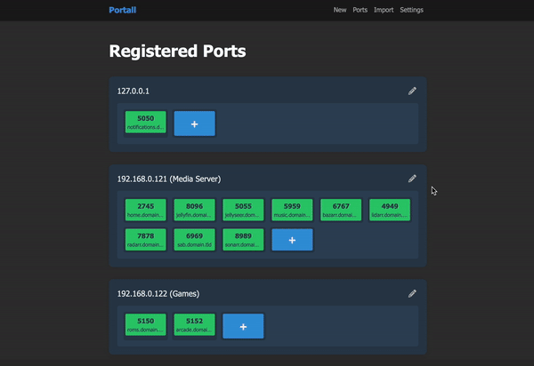
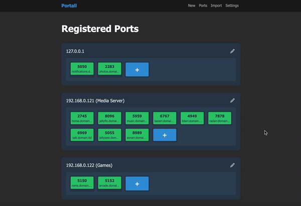

### Port Generator 端口生成器
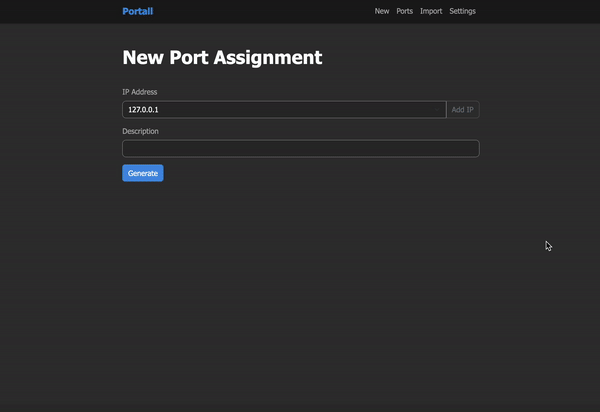
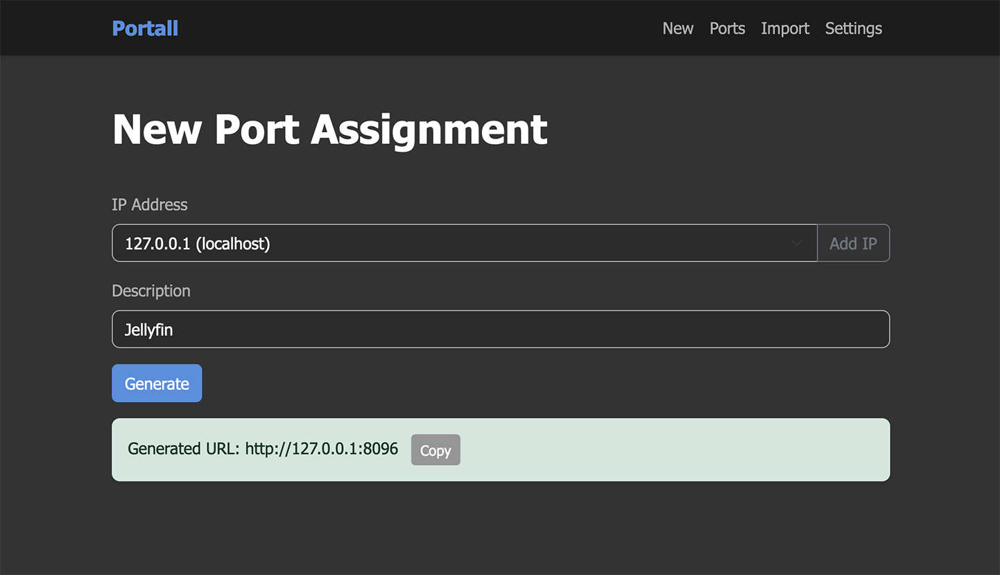

### Import Tool 导入工具
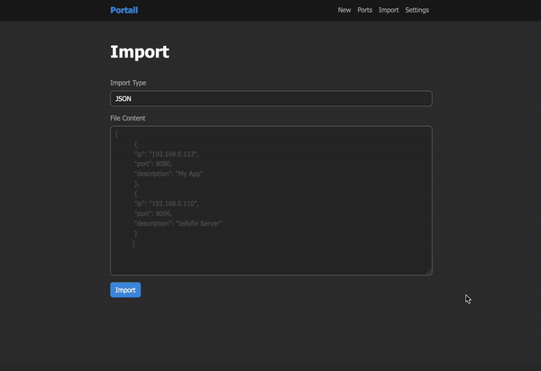
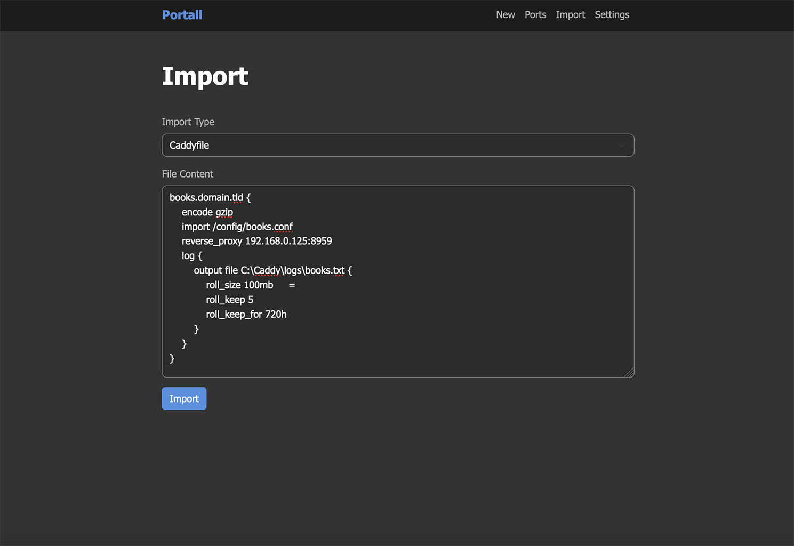

### Settings 系统设置
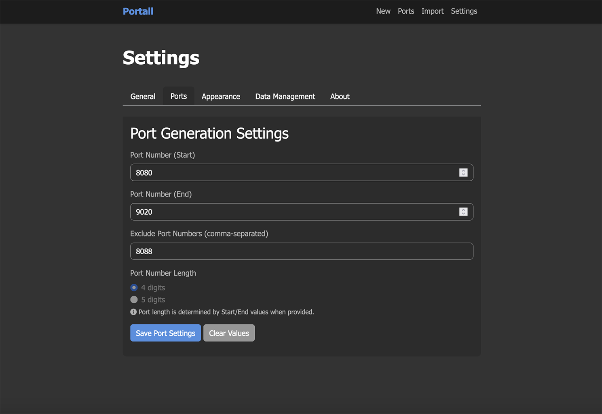
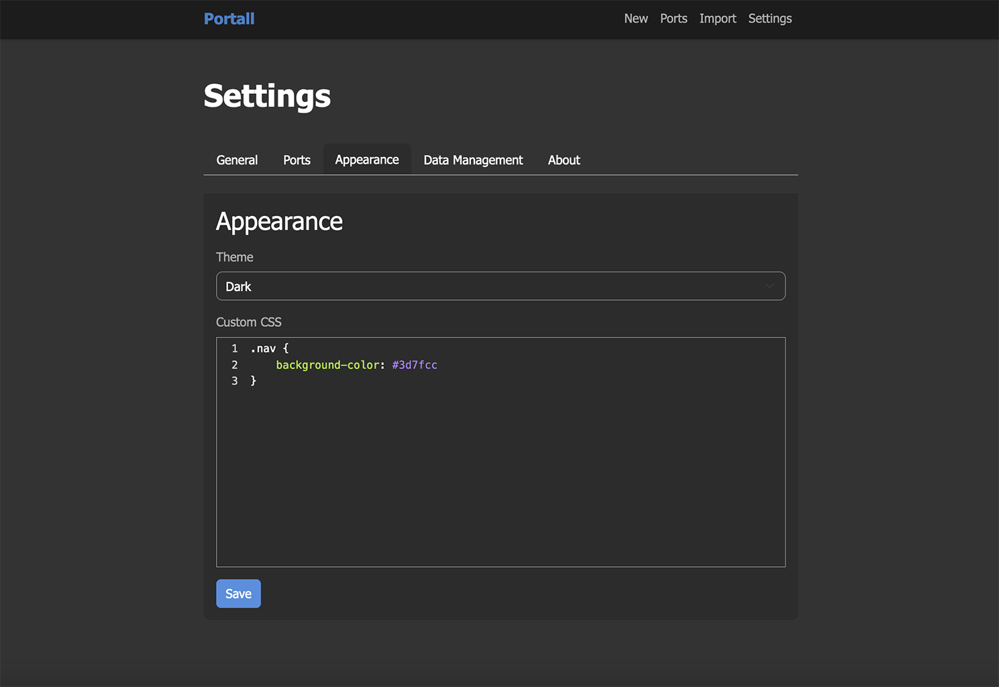
